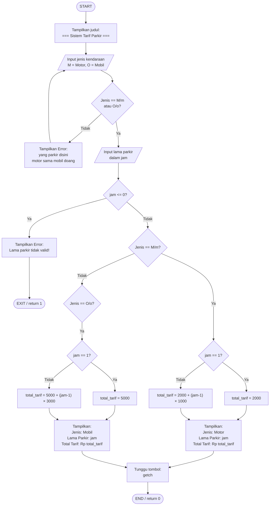

# Flowchart: Sistem Tarif Parkir

## Diagram

---

## Penjelasan Tiap Blok

| Simbol | Arti |
|--------|------|
| Oval `([...])` | START / END — titik awal dan akhir program |
| Kotak `[...]` | Proses — perintah yang dijalankan |
| Jajaran genjang `/[...]/` | Input/Output — ambil input dari user atau cetak ke layar |
| Belah ketupat `{...}` | Keputusan (if/else) — cek kondisi, keluar dua arah |

---

## Alur Singkat

1. **Mulai** → tampilkan judul
2. **Input jenis** kendaraan → validasi loop sampai bener
3. **Input jam** → cek valid (harus > 0)
4. **Percabangan Motor** → hitung tarif Motor
5. **Percabangan Mobil** → hitung tarif Mobil
6. **Tampilkan hasil** → tunggu tombol → **Selesai**

---

## Rumus Tarif

**Motor (M):**
$$\text{Tarif} = 2000 + (\text{jam} - 1) \times 1000$$

**Mobil (O):**
$$\text{Tarif} = 5000 + (\text{jam} - 1) \times 3000$$

> Catatan: jika jam = 1, hanya dikenakan tarif jam pertama saja.
