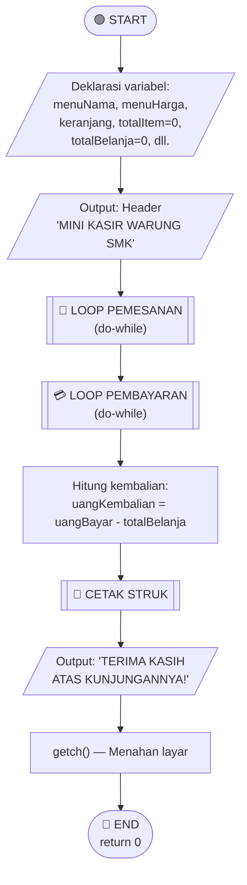
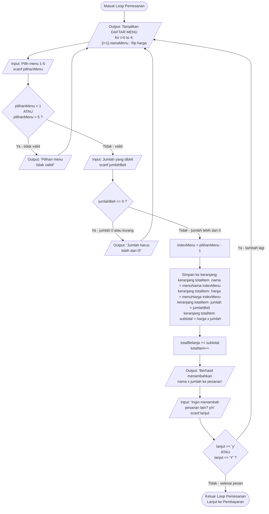
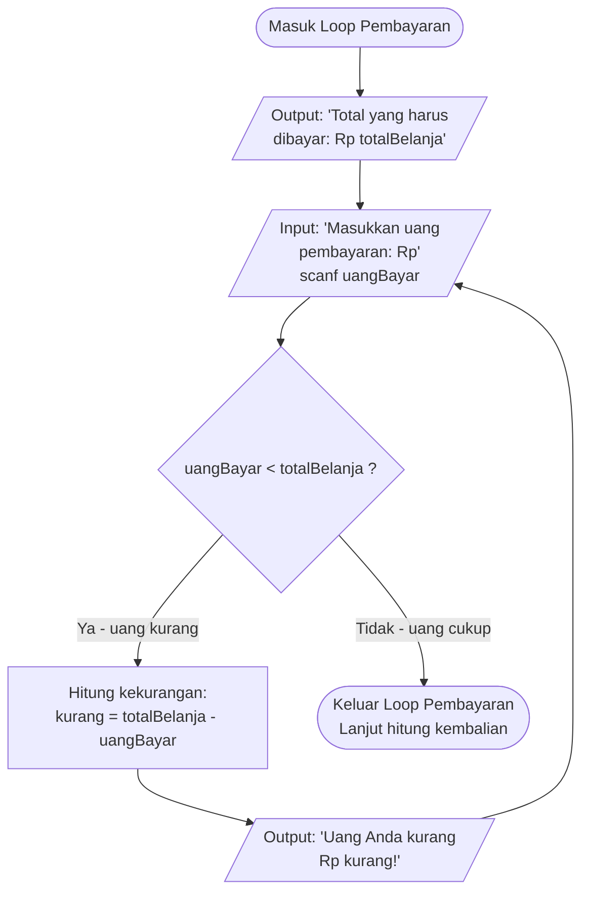
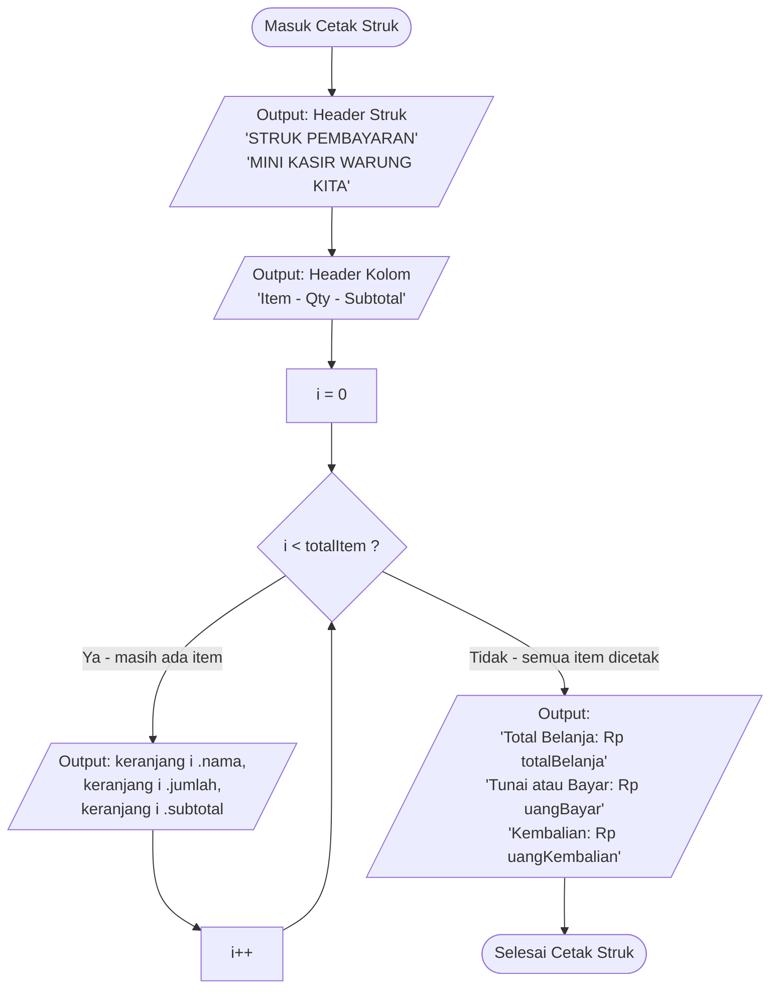
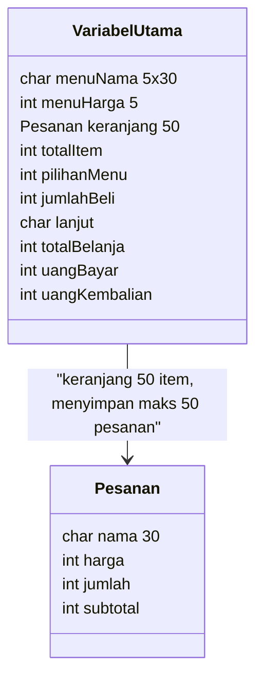
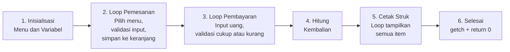

# 📊 Flowchart Sistem Kasir — `kasir.c`

## 1. Penjelasan Bentuk-Bentuk Diagram (Simbol Flowchart)

Berikut adalah simbol-simbol standar flowchart yang digunakan dalam diagram sistem kasir ini:

| No | Simbol | Bentuk | Fungsi / Keterangan |
|----|--------|--------|---------------------|
| 1 | **Terminator** | Oval / Stadium `([...])` | Menandakan **awal (Start)** dan **akhir (End)** dari program |
| 2 | **Process** | Persegi Panjang `[...]` | Menandakan **proses / operasi** yang dilakukan (misal: hitung total, simpan data) |
| 3 | **Decision** | Belah Ketupat `{...}` | Menandakan **percabangan / kondisi IF** yang menghasilkan Ya/Tidak |
| 4 | **Input/Output** | Jajaran Genjang `[/...\]` | Menandakan **operasi input** dari user atau **output** ke layar |
| 5 | **Predefined Process** | Persegi Panjang Bergaris Ganda `[[...]]` | Menandakan **sub-proses / blok kode** yang sudah terdefinisi |
| 6 | **Loop Connector** | Panah kembali ke node sebelumnya | Menandakan **perulangan (loop)** seperti `do-while` |

---

## 2. Flowchart Utama — Alur Keseluruhan Program

Flowchart ini menggambarkan alur **keseluruhan** program kasir dari awal sampai akhir.

---

## 3. Flowchart Detail — Loop Pemesanan (do-while #1)

Bagian ini adalah inti dari proses pemesanan. Terdapat **2 percabangan IF** dan **1 loop do-while**.

### Penjelasan Percabangan pada Loop Pemesanan:

| No | Kondisi IF | Lokasi di Kode | Aksi jika TRUE | Aksi jika FALSE |
|----|-----------|----------------|----------------|-----------------|
| 1 | `pilihanMenu < 1 \|\| pilihanMenu > 5` | Baris 50 | Tampilkan pesan error, `continue` (kembali ke awal loop) | Lanjut ke input jumlah |
| 2 | `jumlahBeli <= 0` | Baris 59 | Tampilkan pesan error, `continue` (kembali ke awal loop) | Lanjut simpan ke keranjang |
| 3 | `lanjut == 'y' \|\| lanjut == 'Y'` | Baris 80 | Kembali ke awal loop (tampilkan menu lagi) | Keluar loop, lanjut ke pembayaran |

---

## 4. Flowchart Detail — Loop Pembayaran (do-while #2)

Bagian ini memvalidasi apakah uang yang dibayarkan cukup.

### Penjelasan Percabangan pada Loop Pembayaran:

| Kondisi IF | Lokasi di Kode | Aksi jika TRUE | Aksi jika FALSE |
|-----------|----------------|----------------|-----------------|
| `uangBayar < totalBelanja` | Baris 91 | Tampilkan kekurangan, minta input ulang | Keluar loop, uang diterima |

---

## 5. Flowchart Detail — Cetak Struk Pembayaran

### Penjelasan Perulangan pada Cetak Struk:

| Tipe Loop | Lokasi di Kode | Kondisi | Fungsi |
|-----------|----------------|---------|--------|
| `for` loop | Baris 107-112 | `i < totalItem` | Mencetak setiap item dalam keranjang satu per satu |

---

## 6. Peta Struktur Data

---

## 7. Ringkasan Alur Sistem

---

## 8. Tabel Ringkasan Seluruh Percabangan & Perulangan

| No | Tipe | Kode | Baris | Tujuan |
|----|------|------|-------|--------|
| 1 | `do-while` | `do { ... } while (lanjut == 'y')` | 38-80 | Loop utama pemesanan menu |
| 2 | `if` | `pilihanMenu < 1 \|\| pilihanMenu > 5` | 50 | Validasi nomor menu yang dipilih |
| 3 | `if` | `jumlahBeli <= 0` | 59 | Validasi jumlah pembelian |
| 4 | `for` | `for (i = 0; i < 5; i++)` | 40-42 | Menampilkan daftar menu |
| 5 | `do-while` | `do { ... } while (uangBayar < totalBelanja)` | 87-94 | Loop validasi pembayaran |
| 6 | `if` | `uangBayar < totalBelanja` | 91 | Cek apakah uang bayar cukup |
| 7 | `for` | `for (i = 0; i < totalItem; i++)` | 107-112 | Mencetak item di struk |

> **Catatan:** Program ini menggunakan `continue` pada validasi input (baris 52 dan baris 62) yang menyebabkan alur langsung **melompat kembali ke awal loop** tanpa mengeksekusi kode di bawahnya. Ini ditunjukkan pada flowchart sebagai panah yang kembali ke node "Tampilkan Daftar Menu".
